# BioVerify - A Web3 Peer-Review Case Study

BioVerify is a peer-review experiment on testnets (Base Sepolia and Ethereum Sepolia). Authors stake ETH to submit a paper, an AI agent screens it for plagiarism, reviewers drawn by Chainlink VRF sign their reviews, and an agent settles stakes, rewards and slashes on-chain. Research artifacts are pinned to IPFS and referenced by CID.

It is a personal project, built solo from January to April 2026. The reviewer draw is verifiable on-chain, but settlement still trusts one agent key and, outside escalation, an LLM's reading of the reviews: see [Known bugs and trust assumptions](#known-bugs-and-trust-assumptions).

---

## Why

The legacy scientific model has a few deep problems. Published papers point to mutable URLs — data can silently change or disappear after publication. Reviewer selection is opaque. Neither publishers nor reviewers are properly rewarded for their work. And the reproducibility crisis has eroded trust in research findings at a foundational level: studies that cannot be replicated are often never flagged or corrected.

DeSci offers a different set of primitives. Content-addressed storage like IPFS means a link to data is a commitment to that exact data — no silent edits, no rot links. On-chain coordination makes reviewer selection auditable and incentive structures explicit.

BioVerify is an experiment in that direction: authors, reviewers and agents need an outcome over days, with stakes, rewards and slashes recorded on-chain, and research artifacts addressed by their IPFS CID.

BioVerify separates concerns across two layers with distinct responsibilities:

- **Truth layer — blockchain.** Stakes, lifecycle states, reviewer selection and settlements are recorded in [`BioVerifyV3`](apps/contracts/src/BioVerifyV3.sol), which is the source of truth for balances and status. The contract checks *whom* a settlement can touch (only the drawn reviewers, with stake locked on that paper), but the verdict itself comes from the agent.
- **Orchestration layer — agents.** LangGraph drives the screening and review graphs ([`@packages/agents`](packages/agents)). A review can pause for days: the graph stops at `interrupt()` and its state waits in Postgres (LangGraph checkpointer) until the next signed review resumes it. Inngest starts each agent run and retries it on failure.

---

## Try the Live Demo

To explore the live demo, you need a browser wallet ([MetaMask](https://metamask.io/) works) funded with Base Sepolia ETH — grab some free from the faucet below. No local setup required.

1. Open the **[live demo](https://bio-verify-ai-dapp.vercel.app/)**.
2. Connect a wallet (Base Sepolia or Ethereum Sepolia).
3. Submit a publication or register as a reviewer — the agents handle the rest.

Want status updates? Open the [BioVerify Telegram Bot](https://t.me/BioVerifyBot) to receive status updates as publications move through screening, review, and settlement — no need to keep the app open.

Need testnet ETH? [Sepolia Faucet](https://sepolia-faucet.pk910.de/) · [Superbridge to Base Sepolia](https://superbridge.app/base-sepolia)

---

## Solution

**Chain events drive the app.** [`BioVerifyV3`](apps/contracts/src/BioVerifyV3.sol) emits events instead of relying on view-heavy reads for product state. Alchemy Notify delivers logs to the Next.js webhook ([`route.ts`](apps/fe/app/api/webhooks/alchemy/all-events/route.ts)), where the payload is verified via **HMAC-SHA256** before [`processContractEvent`](packages/cqrs/src/commands/sync/events.ts) projects events into **Neon Postgres** with optimistic concurrency on `(blockNumber, logIndex)` (see [`@packages/cqrs`](packages/cqrs/README.md)). The frontend reads the projection; it is complemented by a viem WebSocket subscription to `NewPublicationStatus` that invalidates the TanStack Query cache as soon as a status event is mined, so open publication lists reflect the new on-chain status without waiting for the webhook round-trip.

Each agent run starts in **Inngest**, which retries it on failure (one `step.run` around the whole agent). **LangGraph** runs the screening and review graphs; LLM output is schema-constrained before it becomes an allowed command. Reviewers sign their reviews with **EIP-712** in their wallet; the server verifies the signature with viem ([`verify-review-eip712.ts`](packages/utils-server/crypto/eip712/verify-review-eip712.ts)) and the agent then records on-chain that the reviewer has reviewed (a flag, not the signature). After the first review, the review graph resumes from a Next.js server action, outside Inngest.

### Publication lifecycle

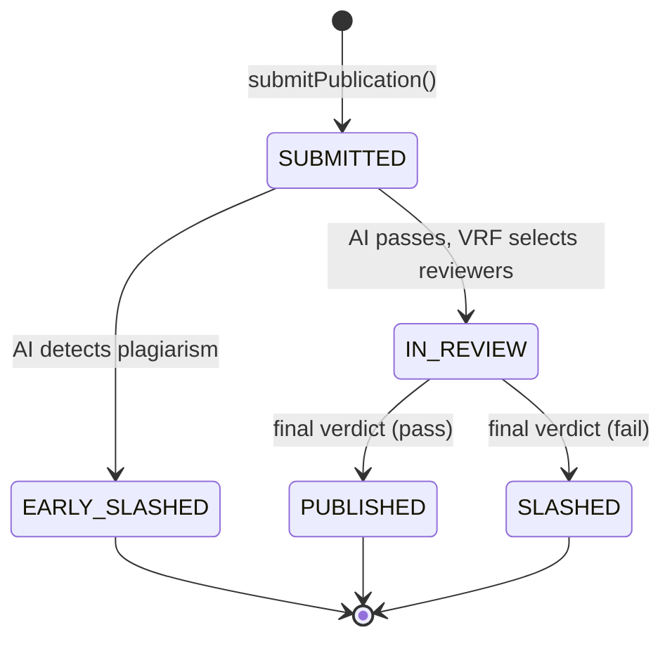

### Who decides

| Step | Decided by |
|:-----|:-----------|
| Plagiarism screen (early slash) | One Gemini call over Exa's search results. No human. |
| Reviewer draw | Chainlink VRF, on-chain. The senior reviewer is the drawn reviewer with the highest reputation. |
| Reviews | People: two peers, each signing their review. |
| Verdict without escalation | Gemini reads the two peer reviews and returns pass, fail or escalate. Pass or fail stands, and the reviewer who disagreed with it is slashed. |
| Verdict after escalation | The senior reviewer. The code enforces the senior's decision. |
| Settlement on-chain | The agent key, with the verdict above. The contract checks the reviewer list, not the verdict. |

### Terminal outcomes

| Outcome | Publisher | Reviewers |
|:--------|:----------|:----------|
| **Early Slashed** | Stake slashed, reputation penalty | None selected |
| **Published** | Stake returned, reputation boost | Honest: stake + reward + rep · Negligent: slashed stake + rep penalty |
| **Slashed** | Stake slashed, reputation penalty | Honest: stake + reward + rep · Negligent: slashed stake + rep penalty |

---

## Architecture

The protocol is split across three layers, each documented separately:

- **Truth layer** — Solidity contract: [`apps/contracts/README.md`](apps/contracts/README.md)
- **Read model** — event projection and on-chain commands: [`packages/cqrs/README.md`](packages/cqrs/README.md)
- **Orchestration** — submission and review graphs: [`packages/agents/graphs/submission/README.md`](packages/agents/graphs/submission/README.md) · [`packages/agents/graphs/review/README.md`](packages/agents/graphs/review/README.md)

For full sequence diagrams, see [`docs/architecture.md`](docs/architecture.md).

### System overview

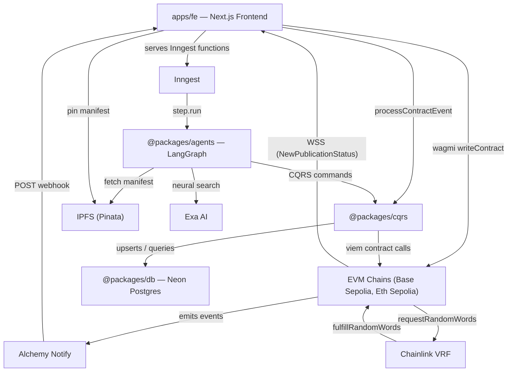

### Event-driven data flow

Contract mutations emit events → Alchemy Notify POSTs a webhook (HMAC-SHA256 verified in [`apps/fe/app/api/webhooks/alchemy/all-events/route.ts`](apps/fe/app/api/webhooks/alchemy/all-events/route.ts)) → `processContractEvent` upserts the Postgres projection → frontend queries hit Postgres. A viem WebSocket client subscribes to `NewPublicationStatus` and invalidates the matching TanStack Query keys on every event, propagating status transitions into open lists in real time.

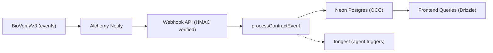

### Agent orchestration

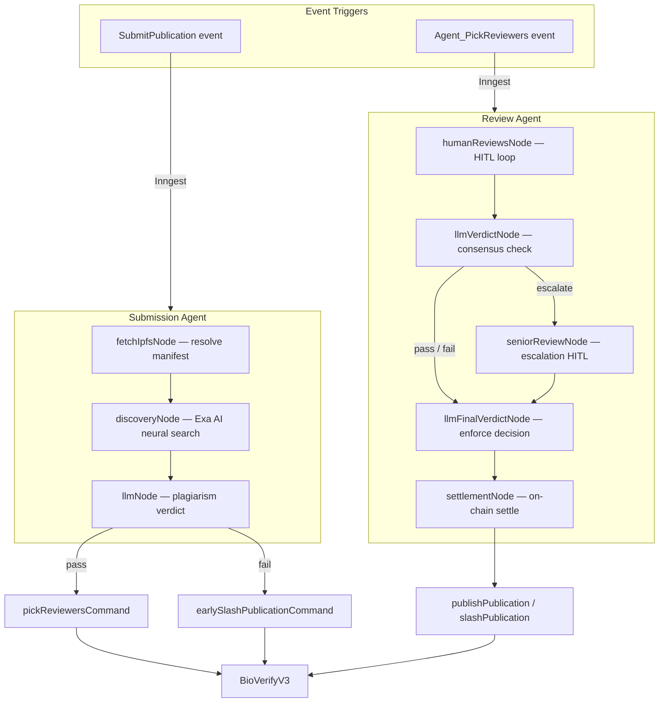

LangGraph uses checkpointers so a workflow can pause for days during human review and resume where it left off. Inngest retries the agent run that a chain event starts; there is no `waitForEvent`, and the only fan-out is one follow-up event after screening. A retry re-runs the whole agent, so its commands read state before writing where they can. Graph-by-graph reference: [`submission/README.md`](packages/agents/graphs/submission/README.md), [`review/README.md`](packages/agents/graphs/review/README.md).

### Smart contract notes

- **CEI + `nonReentrant`** on ETH-out paths (`claim`, `transferSlashPoolToTreasury`).
- **Pull payments** — rewards are credited on-chain; reviewers withdraw via `claim` and pay their own gas, so settlement stays bounded as reviewer count grows.
- **Agent-gated transitions** — sensitive moves use a configured agent address, not arbitrary callers.
- **Few getters** — there are no getters for publications or members; that state is projected from events. Pools, configuration (`I_*`) and the owner stay public. This keeps the contract smaller; each write emits several events, which costs a little more gas.
- **EIP-712** — reviewers sign their review in their wallet; the domain binds the chain id and the contract address, and the server checks the signer is one of the drawn reviewers before the agent records the review.
- **Settlement input is checked** — the agent's honest and negligent lists must contain exactly the drawn reviewers, each with stake locked on that publication; the publisher and duplicates revert.
- **Chainlink VRF v2.5** — Chainlink's coordinator verifies the randomness proof, then calls the contract back with the random words. The submission fee (`msg.value` minus the stake) funds the VRF subscription.

See [`apps/contracts/README.md`](apps/contracts/README.md) for the full contract reference (types, functions, events, staking mechanics).

### Idempotency and consistency

Webhook handling keeps one `(blockNumber, logIndex)` stamp per row and skips any event older than it, so a repeated delivery is harmless (see [`@packages/cqrs`](packages/cqrs/README.md)). The webhook answers `200` before it processes the payload, so a projection that fails is lost, and there is no tool yet to rebuild the read model from chain history. The projection follows the chain tip, with no confirmation depth; open publication pages also re-read the database every 5 to 10 seconds until the paper is final.

---

## Testing

Smart-contract tests live under [`apps/contracts/test/`](apps/contracts/test/) and run via Foundry — VRF mocks, named revert paths, VRF edge cases (collisions, a pool that shrinks, rewards that run out, a receiver that rejects ETH) and a fuzz test on `submitPublication`. The tests are in 11 files (deployment, payReviewerStake, submitPublication with its fuzz contract, earlySlash, pickReviewers, fulfillVRF, recordReview, publishPublication, slashPublication, claim, poolManagement), 12 suites in all, plus a shared base and helpers.

- **50 tests in 12 suites, all passing.**
- **`src/BioVerifyV3.sol`: 100% of lines (240/240), branches (37/37) and functions**, from `forge coverage` on commit `03378a6` (24 October 2026).

Only the contract has automated tests; the agents, the read model and the frontend have none.

See [`apps/contracts/README.md`](apps/contracts/README.md) for the contract reference.

```shell
pnpm contract:test    # forge test
pnpm contract:cov     # forge coverage
```

---

## Tech Stack

### Core architecture

| Area | Technologies |
|------|----------------|
| Smart contracts | Solidity, Foundry, OpenZeppelin, Chainlink VRF V2.5 |
| Agents & AI | LangGraph.js, Gemini (structured output), Exa AI (neural search) |
| Infrastructure | Inngest, Alchemy Notify, Vercel Functions |
| Data & storage | Neon Postgres, IPFS via Pinata |

### Frontend

| Area | Technologies |
|------|----------------|
| UI | Next.js 16 (App Router, RSC), React 19, TypeScript, Tailwind CSS v4, shadcn/ui |
| Web3 | wagmi v3, viem, Reown AppKit (WalletConnect), EIP-712 |
| Client data | TanStack Query v5, TanStack Table v8, Drizzle ORM, nuqs |

### Tooling and quality

| Area | Technologies |
|------|----------------|
| Testing | Foundry (`forge test`, `forge coverage`), VRF mock |
| Lint / schema | Biome (lint + format), Zod |
| Security patterns | CEI, OZ ReentrancyGuard, EIP-712 (ECDSA), HMAC-SHA256 |

---

## Features in Action

### Submitting a publication (success path)

*Split view: BioVerify Telegram bot (left) and DApp (right).*

The author fills in the publication form (metadata and IPFS manifest) and prepares to submit.

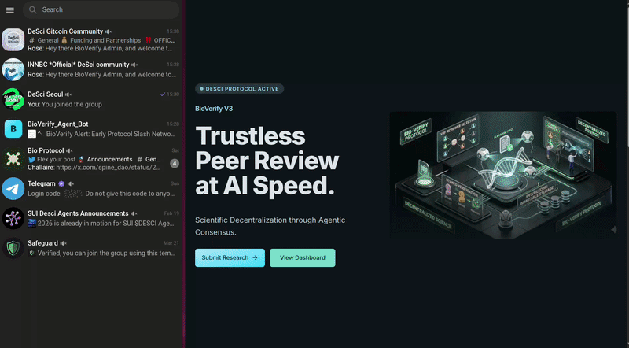


The author confirms the on-chain transaction. The bot receives status notifications as the publication moves from **SUBMITTED** to **IN REVIEW**.

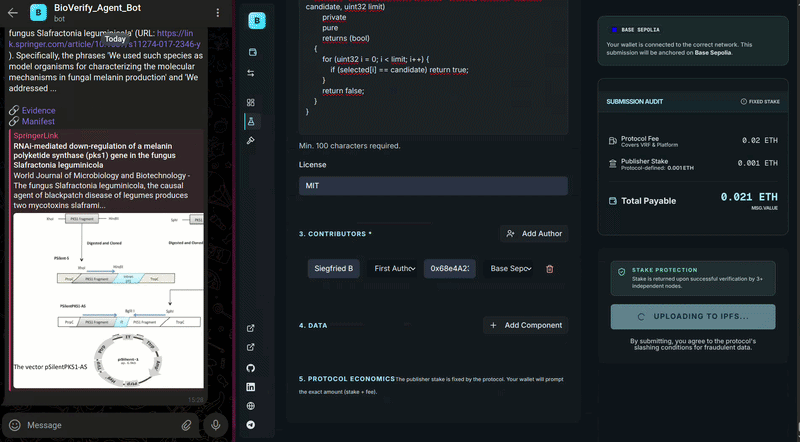

*Watch the Telegram bot reflect each status transition as it happens on-chain.*

The publication detail page shows **IN REVIEW** and the Chainlink VRF–selected reviewers.

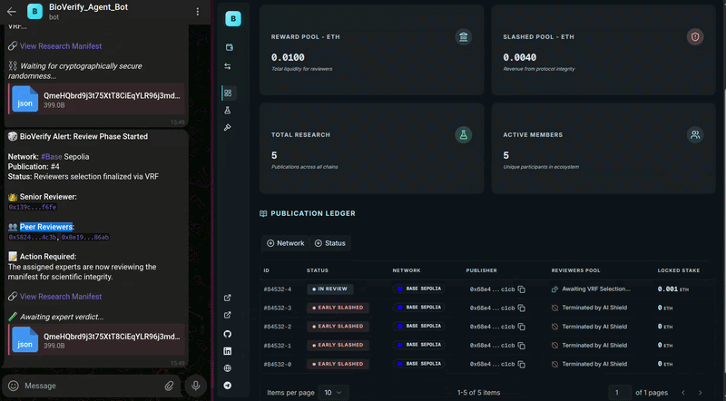

*Watch the VRF-selected reviewer addresses appear in the publication detail panel.*

### Peer review — human-in-the-loop conflict resolution

The first peer reviewer submits a **pass** verdict.

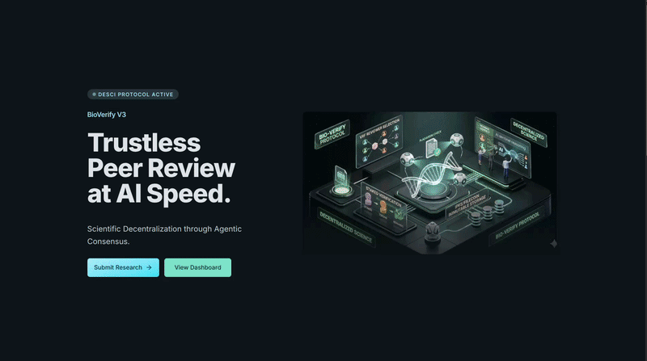

*Watch the Wallet EIP-712 signature prompt — the reviewer signs their verdict off-chain before the agent records it on-chain.*

The second peer reviewer submits a **fail** verdict. The two reviews now conflict, which will trigger the escalation path.

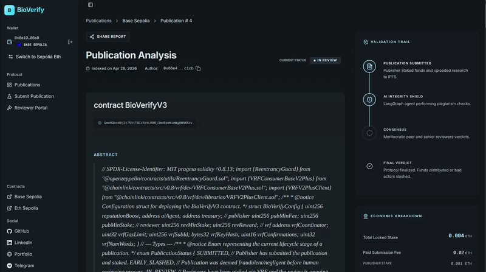


*Split view: Telegram bot (left) and senior reviewer (right).* The bot shows both peer reviews and the agent's decision to escalate. The senior reviewer submits a tie-breaking **pass**.

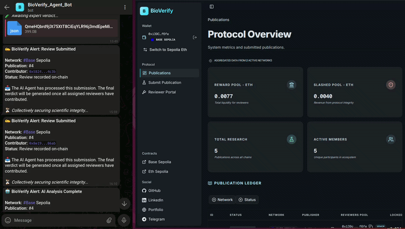

*Watch the senior reviewer break the tie — the agent resumes the paused LangGraph workflow.*

After the senior review, Telegram reflects **PUBLISHED** and the detail page shows the final verdict from IPFS.

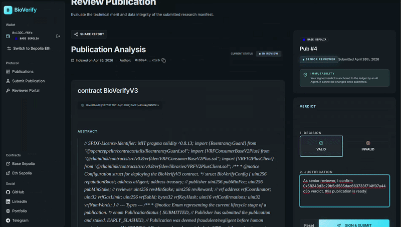

*Watch the final status flip to PUBLISHED and the verdict CID resolve from IPFS.*

### AI plagiarism detection and early slashing

*Dual device view: User A (mobile, no wallet) on `/publications` (left); User B (tablet, wallet on Base Sepolia) (right).*

User B submits a publication that duplicates existing literature.

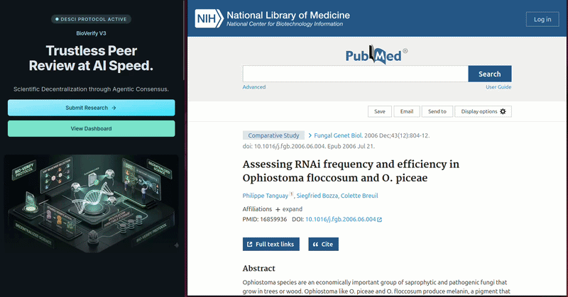


User A sees the row appear in real time over WebSocket (no wallet needed). The publication ends at **EARLY SLASHED** with the AI verdict loaded from IPFS.

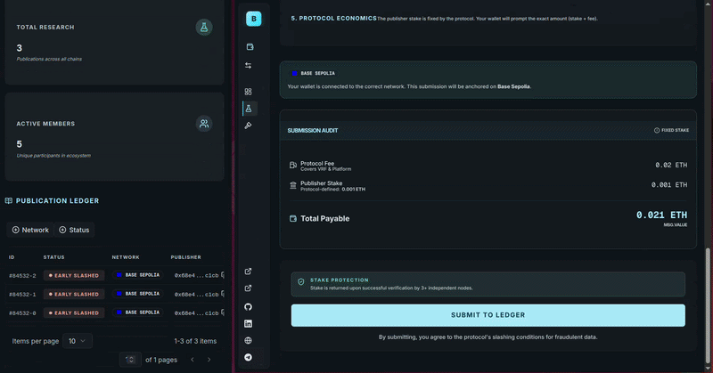

*Watch the publication row appear in User A's list over WebSocket — no wallet, no refresh.*

### Reviewer portal — stake, top-up, claim

A new reviewer joins the pool and pays the reviewer stake.

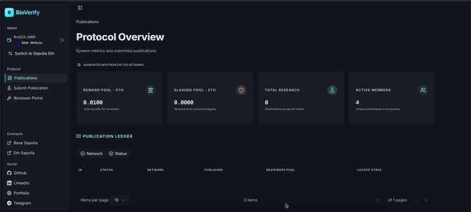

*Watch the reviewer's available stake update after the transaction confirms.*

An existing reviewer tops up so they can be picked in another cycle.

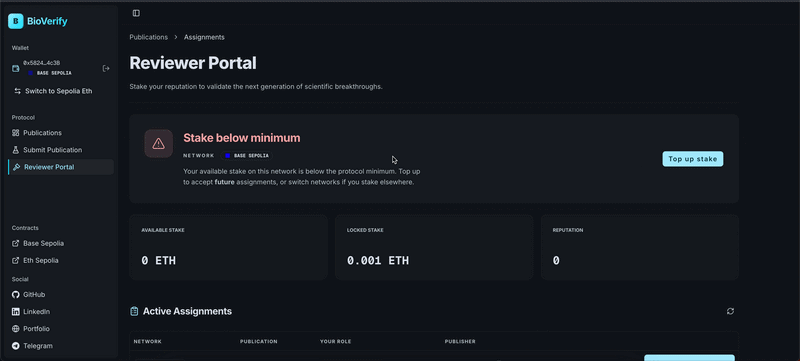

*Watch the available balance increase, making the reviewer eligible for a new review cycle.*

A reviewer claims their available balance (pull withdrawal).

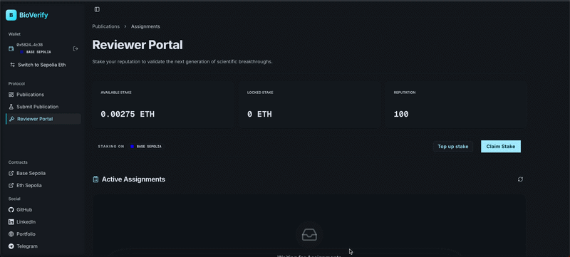

*Watch the pull withdrawal transfer ETH back to the reviewer's wallet.*

### Agent orchestration (Inngest)

Production path: Alchemy webhooks → [`apps/fe/app/api/webhooks/alchemy/all-events/route.ts`](apps/fe/app/api/webhooks/alchemy/all-events/route.ts) → CQRS [`processContractEvent`](packages/cqrs/src/commands/sync/events.ts).

Completed **`submission-agent`** after `CHAIN_SUBMISSION_RECEIVED` (`SubmitPublication` in [`events.ts` lines 158–185](packages/cqrs/src/commands/sync/events.ts)):

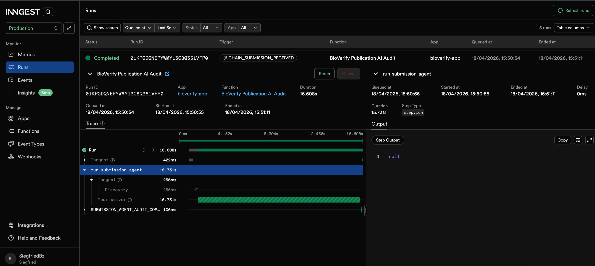

Completed **`review-agent`** after `CHAIN_PICKED_REVIEWERS_RECEIVED` (`Agent_PickReviewers` in [`events.ts` lines 205–229](packages/cqrs/src/commands/sync/events.ts)):

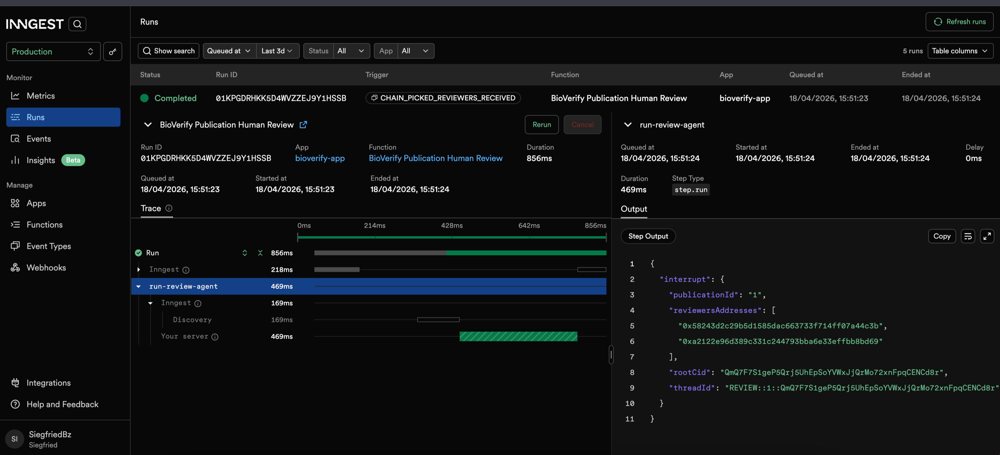

---

## Run it Locally

### Prerequisites

- Node.js 20+
- pnpm 10+
- [Foundry](https://book.getfoundry.sh/) (for contract development)

### Setup

```shell
git clone https://github.com/SiegfriedBz/BioVerify_Agentic_DApp.git
cd BioVerify_Agentic_DApp
pnpm install
cp .env.example .env   # fill in your keys (see packages/env for validation)
```

### Scripts

All scripts run from the monorepo root.

**Frontend**

```shell
pnpm fe:dev                    # start Next.js dev server
pnpm fe:build                  # production build
pnpm fe:start                  # start production server
```

**Contracts**

```shell
pnpm contract:compile          # forge compile
pnpm contract:test             # forge test
pnpm contract:cov              # forge coverage
pnpm contract:deploy:base      # deploy to Base Sepolia + sync config
pnpm contract:deploy:sepolia   # deploy to Ethereum Sepolia + sync config
pnpm contract:sync-config      # regenerate TS config from Foundry artifacts
```

**Database**

```shell
pnpm db:push                   # push Drizzle schema to Neon
pnpm db:seed                   # seed protocol config rows
pnpm db:setup-agents           # initialize LangGraph checkpointer tables
```

**Infrastructure**

```shell
pnpm inngest:dev               # local Inngest dev server
pnpm inngest:sync              # sync Inngest functions to cloud
```

**Quality**

```shell
pnpm lint:check                # Biome lint
pnpm lint:format               # Biome format
```

---

## Deployment

Deployed on 25 April 2026; these are the addresses the app uses ([`bioverfiy-contract-config.ts`](packages/utils/protocol/bioverfiy-contract-config.ts)).

| Network | Contract Address |
|:--------|:-----------------|
| **[Base Sepolia](https://sepolia.basescan.org/address/0xf569d7b5016de6ef0f16fcae82d85d61249df31d)** | `0xf569d7b5016de6ef0f16fcae82d85d61249df31d` |
| **[Ethereum Sepolia](https://sepolia.etherscan.io/address/0xfce6990d551a60f8640a498b6bc34a15822ba3e3)** | `0xfce6990d551a60f8640a498b6bc34a15822ba3e3` |

On both networks one wallet of mine is the agent, the treasury and the contract owner.

---

## Design Decisions and Roadmap

### Current design choices

- **Automated slashing** — When plagiarism is detected in screening, the contract slashes stakes immediately rather than opening a manual appeals path first.
- **Senior reviewer tie-break** — If peer reviewers disagree, the highest-reputation reviewer is escalated via a second HITL step instead of a full quorum re-vote.
- **Few getters** — BioVerifyV3 emits events for state changes and has no getters for publications or members; the app reads from the Postgres projection.

### Known bugs and trust assumptions

- **One agent key settles everything.** A single immutable agent address drives every transition (pick reviewers, early slash, publish or slash). On both deployments it is also the treasury and the owner, and the owner can change the VRF coordinator. The contract limits *whom* the agent can slash (only reviewers with stake locked on that publication), not the verdict.
- **LLM decisions without a human.** The plagiarism early slash is one Gemini call over Exa's top results. Without escalation, Gemini decides pass or fail from the peer reviews, and the reviewer who disagreed is slashed. Signed reviews are verified off-chain; the contract stores a flag per review, and the signatures stay in the private checkpoint database.
- **`pickReviewers` status check.** It checks `status != IN_REVIEW` instead of `== SUBMITTED`, so the agent could re-open a finished publication (and re-send `paidSubmissionFee`). Untested.
- **Stuck VRF callback.** If the reviewer pool shrinks or rewards run out between the VRF request and the callback, `fulfillRandomWords` reverts, VRF does not retry, and the publication stays `IN_REVIEW` for good (a second `pickReviewers` reverts).
- **Read model.** One `(block, logIndex)` stamp per row with partial updates, so a late event that changes another column is dropped; projections that fail after the webhook's `200` are lost, with no replay job. The webhook's HMAC is compared with `===`, not in constant time.
- **Settlement has no retry.** It runs in the Next.js server action that resumes the last review, not in an Inngest step.
- **IPFS reads trust the gateway.** The agent fetches content through the Pinata gateway and does not re-hash it against the CID.

### Known limitations

The current implementation covers the happy paths. These edge cases are not handled yet; they are the hardening backlog before any production use.

- **No author recourse against AI or peer-review false positives.** The submission agent can produce a `fail` verdict on a clean manuscript (false plagiarism positive against [`discoveryNode`](packages/agents/graphs/submission/nodes/2.discovery.ts) results), and peer reviewers can reach a binding verdict an author considers incorrect. Today, both outcomes are terminal: [`earlySlashPublicationCommand`](packages/cqrs/src/commands/actions/submission/early-slash-publication.ts) and `slashPublicationCommand` settle immediately, and the only remaining action for the author is `claim` (which does nothing for a slashed stake). There is no contractual path to contest the verdict, no escalation stake, and no second review cycle.

- **Empty or malformed IPFS payload.** If a publisher submits a syntactically valid CID that resolves to an empty manifest (or one whose `payload.abstractCid` points at empty content), the submission graph reaches `llmNode` with an empty abstract, the LLM verdict short-circuits without producing `pass`/`fail`, and `agent-start.ts` throws `Unexpected verdict "pending"`. After Inngest's 3 step retries the publication is left stuck in `SUBMITTED`. The fetch helper ([`fetchIpfs`](packages/utils/ipfs/fetch-ipfs.ts)) only validates HTTP status, and there is no Zod validation of the manifest shape inside [`fetchIpfsNode`](packages/agents/graphs/submission/nodes/1.fetch-ipfs.ts). Also, sending an empty abstract to Exa is currently avoided only by a truthy check in [`discoveryNode`](packages/agents/graphs/submission/nodes/2.discovery.ts); the behavior of submitting a non-empty but garbage abstract to Exa AI has not been characterized.

- **Agent transaction failures.** All CQRS commands ([`pickReviewersCommand`](packages/cqrs/src/commands/actions/submission/pick-reviewers.ts), [`earlySlashPublicationCommand`](packages/cqrs/src/commands/actions/submission/early-slash-publication.ts), [`publishPublicationCommand`](packages/cqrs/src/commands/actions/review/publish-publication.ts), `slashPublicationCommand`, `recordReviewCommand`) call `publicClient.simulateContract` then `agentClient.writeContract` once and re-throw on failure. On the screening path the only retry layer is Inngest's outer `step.run` (3 retries with default backoff); on the review path, which resumes from a server action, there is none. There is no in-command retry with bumped gas, no nonce-conflict recovery, and no detection of transient RPC errors versus actual revert reasons. A gas spike during settlement can leave a publication in `IN_REVIEW` after the last human review is recorded.
- **Chain support is hardcoded.** The two networks are a fixed enum used across the codebase; adding a chain means a new deployment plus changes in several places.

### Roadmap

**Less trust in the agent** — Separate the agent, the treasury and the owner, and record each review's signature on-chain so the contract can check who voted what.

**Weighted majority voting** — Replace the senior tie-break with consensus weighted by on-chain reputation.

**Reputation via ZK-proofs (Reclaim Protocol)** — Allow privacy-preserving proofs of real-world signals (for example h-index or affiliation) without exposing raw credentials; raises the cost of Sybil identities and collusion at scale. See [Reclaim Protocol](https://www.reclaimprotocol.org/).

**Encrypted access and monetisation (Lit Protocol + x402)** — Encrypt IPFS payloads with [Lit Protocol](https://litprotocol.com/); keys release when on-chain conditions hold (paid, assigned reviewer, or publisher). Gate datasets and supplementary material behind micropayments via the [x402 protocol](https://www.x402.org/).

**Internal corpus + RAG** — Index published manifests in Neon + pgvector for similarity checks alongside Exa, improving detection for work already inside BioVerify.

**Author escalation path** — Let the author contest a verdict (AI early-slash or peer-review settle) within a bounded escalation window by posting an escalation stake larger than the original. The contract opens a second review cycle restricted to humans only (no AI screening node), drawing a fresh VRF cohort that **excludes the original reviewers** to avoid bias replay. The second cycle's verdict is binding and reconciles the first one: if the original verdict is **confirmed**, the escalation stake is slashed in addition to the original slash; if **overturned**, prior rewards and slashes are reversed and new rewards/slashes are computed against the new binding verdict (publisher and original reviewers re-credited or re-slashed accordingly). To make this safe, terminal settlement enforcement (`PUBLISHED` / `SLASHED` / `EARLY_SLASHED`) must include an **escalation delay** during which on-chain effects are deferred or kept reversible (for example a per-publication `finalizedAt = block.timestamp + escalationWindow` and a separate `finalize()` agent-gated transition called after the window).

---

## Monorepo structure

```
apps/
  contracts/     BioVerifyV3 Solidity contract (Foundry) — see apps/contracts/README.md
  fe/            Next.js 16 frontend — UI, webhook API, Inngest, WebSocket subscriptions — see apps/fe/README.md

packages/
  agents/        LangGraph agents (submission + review)
  cqrs/          Event projector, DB queries, on-chain commands — see packages/cqrs/README.md
  db/            Drizzle ORM client (Neon Postgres) — see packages/db/README.md
  env/           Type-safe env vars (Zod)
  notifications/ Telegram helpers
  schema/        Zod schemas, DB tables, domain types, Inngest event types
  utils/         Contract config, ABI, network mappings, EIP-712 types
  utils-server/  Server-only utilities
```

Deep dives: [`apps/contracts/README.md`](apps/contracts/README.md) · [`apps/fe/README.md`](apps/fe/README.md) · [`packages/cqrs/README.md`](packages/cqrs/README.md) · [`packages/db/README.md`](packages/db/README.md) · [`packages/agents/graphs/submission/README.md`](packages/agents/graphs/submission/README.md) · [`packages/agents/graphs/review/README.md`](packages/agents/graphs/review/README.md)

---

## License

MIT — Siegfried Bozza, 2026

## Author

**Siegfried Bozza** — Full-stack Web3 engineer (Foundry / Solidity / Chainlink / Node.js / React / Next.js)

BioVerify was built solo, alongside a full-time full-stack role, between January and April 2026.

[LinkedIn](https://www.linkedin.com/in/siegfriedbozza/) 
